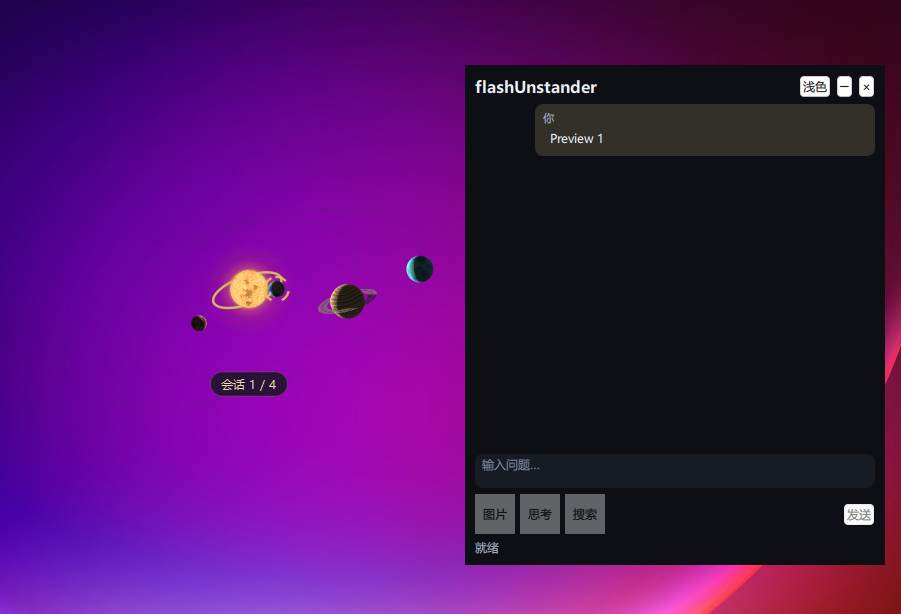

# flashUnstander

Windows 桌面星系问答工具。每颗行星对应一个会话，大小随文本上下文用量变化。重启后，非空会话会恢复为行星。

## 先选你手上的文件

| 手上有什么 | 怎么启动 | 需要安装 Python 吗 |
| --- | --- | --- |
| 单文件 `flashUnstander.exe` | 在 Windows x64 上双击运行 | 不需要，也不需要安装程序或 `_internal` 文件夹 |
| 从 GitHub 克隆的仓库或下载的源码 ZIP | 按下方命令运行源码，或构建 EXE | 需要 Python 3.13 x64 和项目依赖 |

**当前 Git 仓库提供源码、截图和构建脚本。** `flashUnstander.exe` 是本地构建产物，源码 ZIP 里没有它。本次没有向 GitHub 上传可下载的 EXE。要发给普通用户，直接发送构建出来的单个 EXE 即可。

## 首次使用

1. 启动后，桌面会显示恒星悬浮窗。右键恒星，选择「设置」，填入服务商、模型名和你自己的 API Key。
2. 点击恒星或按 `Alt+Shift+W` 新建问答。点击行星恢复会话，滚轮切换选中行星。右键行星可删除对应会话。
3. 在右键「星系外观设置」里调整尺寸、亮度、阴影补光，以及轨道线宽和颜色。

API Key 保存在当前用户的 Windows 凭据管理器，会话保存在 `%LOCALAPPDATA%\flashUnstander`。分发 EXE 时，这些本机数据不会随附。

## 截图




## 从源码运行或构建

在仓库根目录打开 PowerShell，先准备环境：

```powershell
py -3.13 -m venv .venv
.\.venv\Scripts\python.exe -m pip install -r packaging\requirements-windows.txt
```

- **运行源码**。双击根目录的 `启动.cmd`，或在 PowerShell 执行 `.\启动.cmd`。这是开发入口，会保留命令窗口。
- **构建单文件 EXE**。执行 `.\scripts\build-windows.ps1`。产物在仓库根目录 `flashUnstander.exe`，双击可启动且无控制台窗口。
