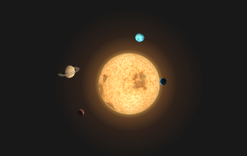

# flashUnstander

Windows x64 桌面星系问答工具。每颗行星对应一个会话，大小随文本上下文用量变化。重启后，非空会话会恢复为行星。

## 下载和启动

手上有 `flashUnstander.exe` 时，在 Windows x64 上双击即可启动。这个单文件已包含所需的 Python 和 Qt 运行时，发给朋友时发送这一个文件即可。

GitHub 仓库提供源码和构建脚本。克隆仓库或下载源码 ZIP 后，可按下面的步骤在本机构建根目录的 `flashUnstander.exe`。

## 首次使用

1. 右键恒星，选择「设置」，选择 OpenAI 或 DeepSeek，填写模型名和自己的 API Key。
2. 点击恒星或按 `Alt+Shift+W` 新建问答。点击行星打开对应会话，右键行星可删除会话。
3. 把鼠标移到恒星上进入选择模式，滚动滚轮在恒星总览和行星近景之间切换。再次进入选择模式时会恢复上次选中的目标。
4. 右键恒星打开「星系外观设置」，可调节天体尺寸、系统亮度、阴影补光、星空透明度，以及轨道线的粗细和颜色。

API Key 保存在当前用户的 Windows 凭据管理器。会话、模型设置和纹理缓存使用 `%LOCALAPPDATA%\flashUnstander` 下的本机数据。

## 0.2.0 星系界面

- Qt Quick GPU 渲染默认启用。星系以 60 帧每秒为目标，公转、自转和飞行动画按实际时间推进。
- 行星近景有带加减速的飞行动画、视差星空、预加载的高分辨率纹理，以及演化的云层和气态风暴。
- 每颗行星生成时约有三成概率带星环，环的颜色、宽度和缝隙随行星变化。未读回复触发极光，正在查看的会话完成回复时也会短暂点亮极光。

## 截图




## 从源码运行或构建

在仓库根目录打开 PowerShell，先准备环境：

```powershell
py -3.13 -m venv .venv
.\.venv\Scripts\python.exe -m pip install -r packaging\requirements-windows.txt
```

- **运行源码**。双击根目录的 `启动.cmd`，或在 PowerShell 执行 `.\启动.cmd`。
- **构建单文件 EXE**。执行 `.\scripts\build-windows.ps1`。构建成功后，仓库根目录会生成 `flashUnstander.exe`，双击启动时无控制台窗口。
- **运行测试**。在根目录执行 `.\.venv\Scripts\python.exe -m pytest -q`。

源码、Windows 测试和打包文件的布局见 [目录地图](docs/DIRECTORY_MAP.md)。经典 Qt 开发示例和 HTML 原型见 [示例说明](examples/README.md)。
